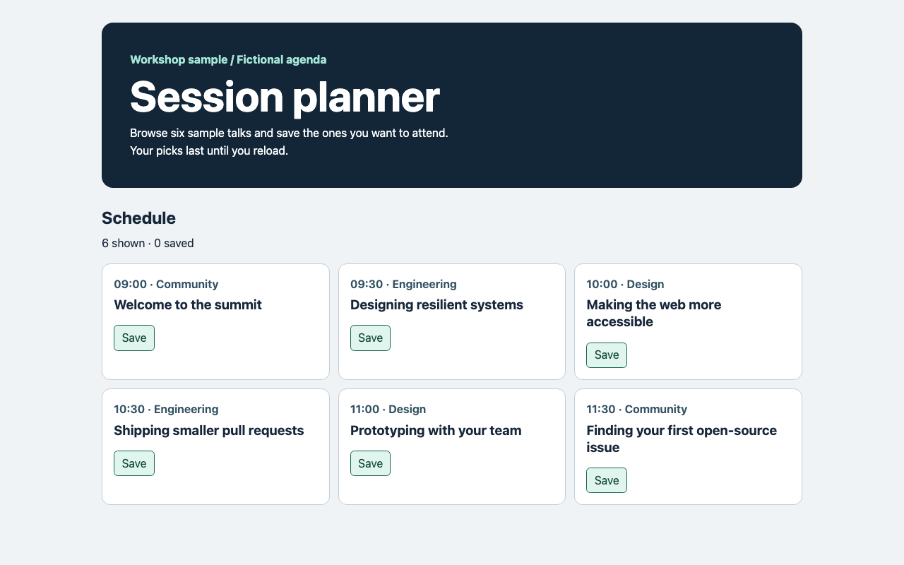
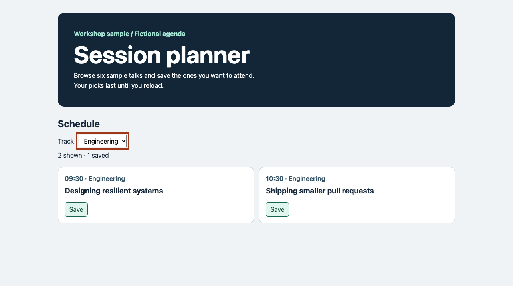

# Mastering the GitHub Copilot App — lab guide

WeAreDevelopers India · 25 November 2026 · 15:30–17:30 IST · Romaan Shair and Siddhat Joshi.

## 0:00–0:18 · Overview (18 min)

A Copilot **Project** keeps context and coordinates work in the Copilot app; it is not a GitHub Projects board. **Fusion** routes model selection for applicable Auto configurations; **subagents** are separately delegated workers. Today you will isolate changes, inspect results and decide when to approve them. The planner schedule is fictional.

## 0:18–0:25 · Readiness (7 min)

Use the [GitHub Copilot app](https://docs.github.com/en/copilot/get-started/quickstart-copilot-app), not just an editor extension. Sign in, open a local clone, and approve repository trust only if you recognize the source. Install Git and Node 22.x (see `.nvmrc`). If you want to practice a PR, work in your own fork.

```sh
npm ci
npm test
npm run build
npm start
```

Open `http://127.0.0.1:4173/planner/`. The starter shows `6 shown · 0 saved`, a Save button on each card, and no Track selector.



*Sample-app screenshot: starter schedule. This is not a screenshot of the Copilot app UI.*

## 0:25–0:45 · Issues, planning and parallel worktrees (20 min)

Read [issue #1: Track filter](https://github.com/roshair/ghcp-app-weareDevelopers-workshop/issues/1) and [issue #2: First-run README](https://github.com/roshair/ghcp-app-weareDevelopers-workshop/issues/2). In the Copilot app, start separate local worktree sessions from your clone's baseline, one for each issue. If upstream issues are not visible in your fork, paste their URLs into the respective sessions. Check the branch and plan before approving. Keep changes separate throughout the lab.

**Feature worktree**

```text
Read the linked track-filter issue and repository instructions. Plan a dependency-free filter that defaults to All tracks, preserves schedule order and saved picks, and updates the visible count. Keep changes in the planner and its tests. Wait for plan approval before editing. Do not push or open a PR.
```

**Documentation worktree**

```text
Read the linked first-run README issue. Plan changes to README.md only. Explain the Node pin and exact commands from the repo root, preview URL, stopping the server and alternative ports on macOS/Linux and PowerShell. Wait for plan approval. Do not push or open a PR.
```

**Done when:** one diff changes planner code/tests; the other changes only `README.md`. In the feature, Tab reaches the labeled Track control, `All tracks` shows six, Engineering shows two in order, and switching back restores six without clearing saved selections.

## 0:45–0:57 · Browser canvas feedback loop (12 min)

Start the server **in the feature worktree**. Open the local URL in the [Browser canvas](https://docs.github.com/en/copilot/how-tos/github-copilot-app/working-with-canvas-extensions). Use the page yourself: save a Community talk, switch to Engineering, then return to All tracks. Tell the agent what you observed, and ask it to verify in the same canvas. Inspect the result after any requested change.

```text
Inspect my planner preview in the Browser canvas. I saved the 09:00 Community talk before choosing Engineering. Verify the count, order and restored saved state. Report the observed results before editing; ask me before changing anything.
```

**Checkpoint:** `2 shown · 1 saved` on Engineering, then `6 shown · 1 saved` on All tracks. If the canvas is unavailable, run the same steps in your browser and paste only the non-sensitive observations into the session.



*Sample-app screenshot: completed feature after saving a Community talk and switching to Engineering.*

## 0:57–1:20 · Review, CI, security and Agent Merge (23 min)

```text
Review my track-filter diff against the issue and report concrete regressions or missing tests with file references. Run npm test and npm run build. Do not edit files or send GitHub comments.
```

Check tests locally and include the browser observations in your PR description. If you have write access and Actions enabled on your own fork, open a practice PR there and inspect the **Planner checks** workflow. Never push to or open a PR against the workshop upstream.

Local security review examines the local change; it is not a CodeQL code-scanning run. The app [security alerts view](https://docs.github.com/en/copilot/how-tos/github-copilot-app/view-and-fix-security-alerts) does not show secret-scanning alerts. In the Agent Merge walkthrough, watch how an agent responds to review feedback or failing checks, and what you would verify before merging. Don't enable paid services in your lab.

**Checkpoint:** green local tests and build, and a short review-ready summary with what changed and how you checked it. If an Actions run is unavailable, use local evidence rather than claiming remote CI passed.

## 1:20–1:30 · Bounded automation (10 min)

If [Automations](https://docs.github.com/en/copilot/how-tos/github-copilot-app/using-automations) is available, create a **manual-only local automation** scoped to your lab clone. Run it once, inspect the run output, then leave it paused/disabled or delete it. Do not enable a recurring schedule, external connectors, or write permissions. If manual operation isn't available, run the prompt once in an ordinary session instead.

```text
Read README.md only. Return five yes/no lines: Node version, install, test, build and launch. Cite the README for each answer. Do not edit files, post anything, invoke external tools or trigger other automations.
```

**Checkpoint:** five auditable lines, no Git changes, and no active recurrence.

## 1:30–1:42 · Advanced walkthroughs (12 min)

Watch how a Copilot session can work with an Azure DevOps item and how Computer Use can interact with a browser. For each walkthrough, identify what the agent can act on and what evidence you would check afterward. No lab setup or additional account is required to follow along.

## 1:42–1:45 · Recovery (3 min)

Keep the current worktree intact. Inspect `git status` and `git diff`; don't reset or force-switch. To resume from a checkpoint, fetch the workshop upstream (use `origin` if it is the workshop repository; otherwise use the upstream URL), then create a fresh worktree in a new directory:

```sh
git fetch https://github.com/roshair/ghcp-app-weareDevelopers-workshop.git checkpoint/pr-ready
git worktree add -b lab-recovery ../planner-recovery FETCH_HEAD
```

Substitute the checkpoint you need and use a new local branch/directory name on repeat. If Node is wrong, select 22.x and rerun `npm ci`; if `4173` is busy, stop the other server or start a new one with `PORT=4174 npm start` (PowerShell: `$env:PORT='4174'; npm start`). Preview `/planner/` on the chosen port. If account access is missing, pair or use the hosted planner and guide. Never paste credentials into chat.

| Branch | Expected state |
|---|---|
| [`checkpoint/start`](https://github.com/roshair/ghcp-app-weareDevelopers-workshop/tree/checkpoint/start) | Working baseline with starter tests, no Track selector. |
| [`checkpoint/feature`](https://github.com/roshair/ghcp-app-weareDevelopers-workshop/tree/checkpoint/feature) | Track filter works; starter tests still pass. |
| [`checkpoint/pr-ready`](https://github.com/roshair/ghcp-app-weareDevelopers-workshop/tree/checkpoint/pr-ready) | Filtering regression tests and reviewer checklist added. |
| [`checkpoint/complete`](https://github.com/roshair/ghcp-app-weareDevelopers-workshop/tree/checkpoint/complete) | Ready feature plus independent README solution. |

## 1:45–2:00 · Q&A and feedback (15 min)

Compare diffs and decisions: what did you approve, inspect, and correct? Share feedback through the [landing page](https://roshair.github.io/ghcp-app-weareDevelopers-workshop/). The form files a public issue and requires GitHub sign-in; leave out private and sensitive details.
